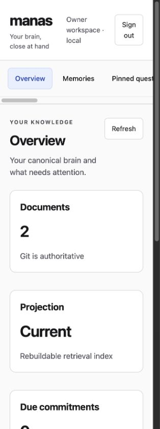

# Owner browser administration

Start the canonical service, then open the owner interface:

```sh
manas service start --repo /absolute/path/to/brain --store /absolute/path/to/operational
manas ui open
```

The service owns both the Unix socket and browser listener and uses one configured
engine, store, providers, authorization checks, and worker queue. The UI does not
open another PGLite database. By default the HTTP listener binds only 127.0.0.1 on
an available port. Use `manas ui start --port 29431` for a chosen port, then
`manas ui open` to sign in. Stop it with `manas ui stop`; the canonical service
continues running. Changing a running listener's port requires stopping it first.

On macOS, ui open launches the default browser and also returns the link. Use
--no-browser or --json to obtain the link without launching a browser. The command
requires an already running canonical service.

The interface provides:

- Canonical brain and projection status, local inference configuration and endpoint checks.
- Searchable memories, owner capture, corrections, withdrawal, and explicit owner history.
- Pinned questions, answer freshness, and queued refresh.
- Cited commitments created from retrieved primary evidence, completion status, and
  explicitly requested local reminders with delivery state.
- Meeting preparation from participants, recent interactions, and open commitments.
- Read-only Google account consent with a selected source, collection, interval,
  and private visibility; source freshness, sync, and ingestion enable/disable.
- Maintenance proposal evidence, relationship acceptance and dismissal, and
  entity-review comparison, merge, separation, or rejection.
- Background job progress, failures, and cancellation.
- Existing client credential metadata and explicit revocation.

Provider configuration remains in the versioned configuration file. Edit local
provider settings there and restart the service; the interface checks configured
endpoints and distinguishes this from proof that a specific model can complete
inference. Codex/Claude installation and hook trust remain available through the
ownership-aware agents commands. Scopes and integration observations do not become
owner browser credentials. Device enrollment and Tailscale management remain a
separate part of rollout.

Each sign-in link expires after sixty seconds and can be used once. It is issued
only through the authenticated owner Unix socket. The ticket is in the URL fragment,
removed immediately by the page, and never used as an HTTP query parameter.
Pending tickets are bounded and held only in memory. A service restart invalidates
unused links.

Browser sessions use a dedicated operational table, separate from MCP access
tokens, OAuth grants, and generic web sessions. Only hashed session and CSRF secrets
are persisted. Sessions are bound to the current brain and exact origin, expire
after thirty minutes idle and eight hours absolute, and require CSRF protection for
every API request. Cookies are HttpOnly and SameSite=Strict. The loopback HTTP
listener does not accept forwarded origins. Host and Origin checks prevent DNS
rebinding and cross-site requests. No CORS access is enabled.

The server rechecks session revocation after long operations before returning data.
Logout revokes that session; restoration revokes every restored owner session.
The CSP permits only local scripts, styles, and API connections, denies framing,
and disables inline script execution. Source material is rendered as text.
Responses are no-store, input is bounded to 256 KiB, and output is bounded to 8 MiB.
Browser administration exposes an explicit subset of the canonical catalog.

Repeated submission of the same unchanged capture form retains its idempotency key.
Corrections and withdrawals include the exact displayed revision. Withdrawal removes
ordinary access while explicit owner Git history remains available.

The responsive UI uses system fonts, visible keyboard focus, labelled controls,
semantic landmarks, live status messages, touch-sized buttons, a skip link, and
reduced-motion support. Browser smoke verification used an isolated temporary brain
for recall, duplicate capture, evidence-based commitment creation, and meeting
preparation. The screenshot below contains disposable fixture data.


